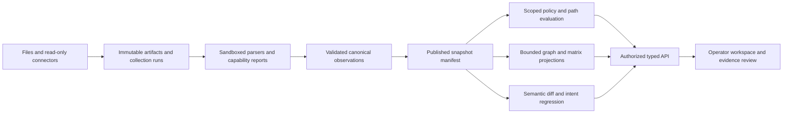

# GraphLayer enterprise overhaul

Status: execution plan; implementation starts with milestone M0. Decision date: October 17, 2026. Audience: enterprise firewall engineering, network operations, security architecture, and platform engineering.

This plan consolidates and revises `SPEC.md`, the frontend proposals, the Rust migration proposal, and `GRAPH_RULE_MATRIX_ENHANCEMENT_PLAN.md`. They remain historical design inputs. This document and its [execution backlog](ENTERPRISE_OVERHAUL_BACKLOG.md) define the enterprise sequence. Nothing here asserts that planned capabilities already work.

## 1. Product decision

Build an evidence-backed network operations workspace that answers five questions:

1. What is connected, where, and how current is that knowledge?
2. Can this exact flow pass, and which route, policy, translation, or missing evidence determines the answer?
3. Where does actual connectivity violate intended segmentation?
4. What will a proposed change open, break, or leave unresolved?
5. Can another engineer reproduce and review the result before acting?

The user selected enterprise firewall/network operations rather than an OT-only or MSP-first product, and asked for a plan followed by implementation. Support disconnected deployment and read-only collection, but make Purdue levels an optional view. Tenant identity, site, network namespace, virtual firewall context, and snapshot identity must exist before externally exposing a service. Initial device writes are out of scope; change review and approval come before any later provisioning integration.

The winning experience is a short, trustworthy investigation: find an endpoint, choose a dated snapshot, enter a flow, inspect the decisive rule and evidence, compare a proposed change, save a reviewable result. A visually impressive topology alone does not satisfy this promise.

## 2. What exists and what does not

The authoritative starting revision is `859d6c447f706b54544f3eaafc4d6109d8067fcd` from fetched `origin/main`. Its newest merged work is PR #10, a graph/matrix planning document. PR #9 added useful engine and test work. No open PR was found during the initial audit.

The original checkout `F:\deepseek\graphlayer` is an older `main` at `34c0809`, with extensive modified files and an untracked Next.js/MongoDB API prototype. It is preserved as work of unknown prior ownership. Its endpoint mismatches, mock analysis, credential handling, and unfinished parser wiring are recovery findings, not shipped-baseline vulnerabilities. The implementation worktree is `F:\deepseek\graphlayer-overhaul-plan`, branch `codex/graphlayer-overhaul-plan`, owned by this overhaul task.

| Area | Evidence in current main | Decision |
|---|---|---|
| Vendor parsing | Go vendor packages, fixtures and mappers | Retain; certify by platform/version/feature instead of counting parser functions |
| Connectors | Python NetBox/ServiceNow and Go collection/orchestration | Retain useful adapters behind a single versioned artifact contract; keep network credentials outside parser workers |
| Correlation | `platform/correlation/` implements dedup and conflicts | Retain; prevent false merges across sites/VRFs and preserve disagreements |
| Confidence | Models plus `platform/scoring/` | Repair deterministic scoring; confidence is evidence quality, not probability that a packet passes |
| Inference | `platform/intelligence/` | Retain as separately labelled inferred claims; never silently upgrade to observations |
| Graph | `platform/graph/builder.go` and exporters | Refactor export-oriented graph into bounded projections; retain algorithms/exporters |
| Policy | Vendor-specific L4 engines in nested orchestration module | Quarantine unproven semantics; establish conservative scoped evaluation before exposing verdicts |
| Comparison | `platform/comparison/`, comparator CLI | Retain metrics; add independent truth, uncertainty and real product captures |
| HTTP application/UI | Absent from committed baseline | Build one coherent application after contracts; evaluate local prototype by behavior, not wholesale merge |
| CI/packaging | Four workflows and CLI-focused QA container | Repair unsupported commands, toolchain mismatch and LFS text configuration |

Verified graph gaps include unbounded whole-graph construction, formatted-string children, fixed lifecycle confidence, and zone IDs that omit virtual context. The L4 dispatcher selects the first populated vendor slice; unresolved named objects are not fully checked. The old matrix plan assumes more shared policy semantics than currently exist. See [audit and recovery notes](ENTERPRISE_OVERHAUL_AUDIT.md) for evidence and limitations.

## 3. Competitive baseline and proof

reference already documents configuration-derived topology, rules review and segmentation workflows. Its release notes list 6.7.0 as a September 22, 2026 general release, including additional parser/connector work. Those capabilities are the parity floor. [Product](https://www.network-perception.com/product), [release notes](https://www.network-perception.com/kb/release-notes).

Enterprise comparisons also need Batfish for configuration semantics and differential reachability, Tufin for policy visibility and change workflows, and AlgoSec/FireMon for operational workflows. A modern graph or a chat interface is not sufficient differentiation. Official descriptions establish advertised features, not comparative accuracy or usability. [Batfish differential questions](https://batfish.readthedocs.io/en/stable/notebooks/differentialQuestions.html), [Tufin SecureTrack](https://www.tufin.com/tufin-orchestration-suite/securetrack), [Tufin SecureChange](https://www.tufin.com/resources/tufin-orchestration-suite/securechange), [AlgoSec AFA](https://techdocs.algosec.com/en/asms/a33.00/asms-help/content/afa-admin/algosec-firewall-analyzer_1.htm), [FireMon workflows](https://docs.firemon.com/enterprise/Content/PLANNER/Workflows/Access_Request/Available_Workflows.htm).

| Dimension | GraphLayer opportunity to test | Required evidence |
|---|---|---|
| Trust | Every result explains decisive facts, unsupported semantics and source lineage | Per-result source references, engine version, coverage, snapshot hash and replay |
| Analyst effort | Unified search, topology, policy, diff and evidence in one investigation | Blinded task study against matched competitors, including setup time |
| Change safety | Named application intents evaluated before/after a proposed snapshot | Seeded exposure and outage changes; no missed critical regressions in supported corpus |
| Mixed sources | Resolve inventory identity without hiding conflicts or duplicated evidence | Multi-site overlapping-address, stale CMDB and contradictory-config fixtures |
| Scale | Fast scoped queries and incremental recomputation with complete evidence | Declared hardware, datasets, p50/p95/p99, memory, quality and fresh-data age |
| Extensibility | Documented parser contract, self-hosted API and portable evidence bundles | A new adapter built by an engineer outside the core team using only the guide |

Superiority is a release criterion, not a present claim. Publish a versioned benchmark protocol before collecting results. Freeze OS/config features, source data, truth labels, hardware, licenses, cache state, comparator versions and task instructions. Use independent adjudication for disagreements. Report unsupported and unknown separately from correct answers; an engine cannot improve its score by abstaining from difficult cases without reporting coverage.

Proposed gates: 100% of reported decisions identify their inputs and coverage; zero known false-permit cases in the critical golden suite; at least 99% disposition accuracy on the explicitly supported suite; at least 95% precision/recall for noncritical change detection; zero missed seeded critical exposure changes; at least 2x faster median completion on matched analyst tasks without more wrong decisions. These are targets and require revision after baseline measurement. Do not market a percentage from a tiny fixture set or claim universal vendor support.

## 4. Product workflows and information architecture

Persistent workspace context: organization, site/scope, snapshot, firewall/virtual context where applicable, data age, and analysis coverage. Every investigation URL includes immutable snapshot and object IDs. Current state is an explicit selection, never an ambiguous mix of device versions.

Navigation: Overview; Sources and Imports; Inventory; Topology; Policies and Segmentation; Investigations; Changes; Reports; Administration. Keep database diagnostics out of ordinary operator tasks. Global search covers names, IPs, prefixes, interfaces, zones, rules, object groups and saved investigations. Search returns scoped candidates when addresses or names are ambiguous.

### Onboard and validate

Upload a config bundle or configure read-only collection. Identify vendor/OS and context; show detected capabilities, parser warnings, unsupported constructs, extraction counts and missing operational inputs. Offer sanitized preview with permission-gated raw evidence. Publish only after validation; a failed import leaves the last ready snapshot active. A partial snapshot remains usable but conspicuously incomplete.

### Explain one flow

Select snapshot, source namespace/VRF, ingress, source/destination addresses, protocol, source/destination port or ICMP fields, and optional application/user/time context. Display policy-only and end-to-end conclusions separately. Explain rule order, object expansion, zones, interfaces, route choice, NAT before/after values and return-path status where supported. Missing object, dynamic application state or unavailable route data yields an explicit indeterminate reason. Allow saving a scenario as an intent regression test.

### Review segmentation

Use a zone-pair overview to find broad, mixed or unresolved policy coverage. Keep device/context identity on matrix axes; same-named zones are distinct unless an explicit grouping maps them. A cell is an aggregate summary with counts, coverage, and links to ordered rules. A tuple-specific filter can request a decision. The matrix must never turn the existence of an allow rule into a declaration that all traffic between two zones passes.

### Assess changes

Compare immutable baseline and proposed snapshots, normalize semantically equivalent ordering/formatting changes, and show policy/object/NAT/route differences. Evaluate saved intents on both. Rank newly exposed services, broken required flows and unresolved dependencies. Separate proposed change, approved review, actual collection, and post-change verification. Save reviewer comments, scope and evidence as an audit record.

### Troubleshoot across topology

Search and focus an asset, then expand its relevant neighborhood. Switch physical/L2, routed/L3, policy and observed-flow layers; each layer represents different relationships, with its own legend and evidence. A shortest graph path is labelled a topology path and is not a firewall reachability verdict. Open an inspector, trace rules/routes/objects, launch a flow investigation and compare revisions without losing selection.

### Report and hand off

Export the selected scope, filters, snapshot identity and analysis assumptions alongside tables/diagram. Redact secrets by default. PDF/CSV/JSON bundles carry generated time, source times, engine/parser versions and coverage warnings. Saved investigations can be reviewed or replayed by another authorized engineer. Compliance mappings are evidence aids; the application does not declare certification merely because a report was generated.

## 5. Canonical data and temporal model

Choose one canonical domain model before migrating adapters. Preserve existing types behind explicit adapters until consumers move. Do not create a third parallel family of graph objects or copy a stale branch wholesale.

Core identities: Organization; Site; Namespace (VRF/VDOM/VSYS/context); Device; Interface; Address/Prefix; Segment/VLAN; Zone; Route; PolicyChain; Rule; AddressObject; ServiceObject; NATRule; Tunnel; Asset; Observation; EvidenceArtifact; CollectionRun; Snapshot; AnalysisRun; Intent; Finding; Review; SavedView.

Rules for identity and time:

- Device identity prefers scoped serial/native ID; IP and hostname alone are weak identities. A prefix/VLAN/zone is qualified by organization/site/namespace/device as appropriate.
- Facts have observed-at, collected-at and valid-for-snapshot times. Confidence calculation also records its evaluation time and model version.
- Immutable source artifacts are content-addressed. Evidence references artifact, parser/version, source command, stanza or line range and transformation. A hash proves content identity; trusted collection metadata/signatures provide stronger origin claims.
- Separate original observations, normalized facts, inferred claims and manual overrides. Overrides have author, reason, scope, expiry and invalidation rules; conflicts remain inspectable.
- Independent evidence groups prevent SSH and an NCM copy of the same configuration from receiving an undeserved corroboration bonus.
- Snapshot manifests select exact device versions, parser/capability versions, reference-catalog versions and artifact hashes. Multi-device collection skew is visible; no fabricated atomic network-wide capture.
- Unknown confidence is distinct from zero and from perfect confidence. Propagation cannot create stronger support than its parents without new evidence. Time-dependent computations use an injected clock.

The unique `sprint1/topology-record-model-v2` commit contains useful record envelopes/schema/adapters but remains unintegrated and overlaps current confidence models. Preserve the branch; recover evidence validation selectively. Reconsider its zero-quality-to-one default. Decide schema in an ADR and test migration before porting it.

## 6. Policy and path correctness contract

The initial evaluator is a pure function over a complete, ordered, device/context/snapshot-scoped policy bundle and a validated concrete flow. It performs no network access and changes no device. Its output includes disposition, decisive rule or default action, considered rules, evidence, supported-semantics declaration and machine-readable reasons.

Use `permit`, `deny`, and `indeterminate`. Keep malformed request/input as validation errors. A definitive permit requires all relevant predicates of the first matching rule to be established. An unresolved earlier rule that might match prevents a later rule from yielding a definitive verdict. A definite nonmatch can eliminate a rule even when another predicate is unsupported. A default is applicable only when policy completeness and the implicit-action semantics are explicitly established. A policy-only permit is not end-to-end reachability.

Implement progressively: explicit IPv4/IPv6 addresses/prefixes; protocol and port semantics; rule order; enabled state; device/context isolation; then named/nested objects with cycle and size limits, negation, schedules/users/applications, zone inheritance and vendor-specific defaults. Maintain a capability matrix per adapter. Do not interpret unresolved object names or services as wildcard matches.

Multi-hop analysis joins directed interface/VRF-aware forwarding, ordered policy chains, NAT evaluation stage, tunnels and stateful return traffic. It needs bounded loop detection, route recursion, ECMP branches, implicit deny, asymmetric routes, overlapping addresses, hairpin/twice NAT and intra-zone behavior. An accepted route alone is insufficient. Start with one firewall and expand only when golden cases prove semantics.

Critical regression matrix: earlier deny/later allow; earlier unresolved/later allow; disabled deny; missing chain; wrong device/context; IPv4/v6 boundaries; CIDR/range/negated sets; source-port vs destination-port; ICMP versus TCP/UDP; nested/cyclic objects; application-default; dynamic identity; schedules/timezones; route loop/no route/null route; NAT pre/post address matching; overlapping VRFs; ECMP mixed outcomes; stateful return path; stale/conflicting snapshots. See backlog for staged delivery.

## 7. Architecture decisions

Start with a modular Go application plus bounded background workers and a Next.js/TypeScript operator UI. Keep existing Python source integrations as adapters exchanging versioned artifacts. Keep parsing, canonicalization, policy evaluation and graph projection independently testable. Avoid both a language rewrite and distributed-service proliferation before behavior and load justify them.

Storage ADR: favor PostgreSQL for relational identity, membership, jobs, reviews and manifest metadata; content-addressed encrypted filesystem/object storage for raw artifacts; rebuildable graph/analysis projections. The committed baseline has no operational Mongo application to preserve, so do not choose Mongo solely because the untracked prototype used it. Validate current parser record shapes, operational indexes, backups and representative queries before committing the storage ADR. Keep the first pure evaluator storage-independent. Do not add Redis, a dedicated graph database, TimescaleDB or Kubernetes until a specific tested need appears.

API: one versioned OpenAPI contract and generated TS client; bounded pagination, typed validation/error envelopes, request IDs, explicit snapshot/scope and stable job states. Web UI and exports consume the same authorized projections. Begin with REST; add SSE for job progress. Use ETags and snapshot-keyed caches. Do not expose arbitrary database collections.

Jobs: persisted queued/running/succeeded/partial/failed/cancelled state; idempotency keys; bounded per-source and per-organization concurrency; leases; retry classification/backoff; heartbeat; cancellation; resume after restart; atomic snapshot activation. Failed build preserves last successful snapshot. Worker authority must be limited to its artifact/job scope.

No Rust port is scheduled now. Benchmark actual parser, evaluation and projection hot paths before adding FFI or a second engine implementation. Revisit only with a recorded bottleneck, a compatibility contract and a measured improvement.

## 8. Graph, matrix and visual design

Topology is a typed directed multigraph. Physical adjacencies may be bidirectional; routes, policy edges and observed flows retain their own direction. Relationships and policy coverage are not interchangeable. Stable IDs include namespace/context; exported edge endpoints must exist in the selected projection. Grouping adds typed parent/child relationships and preserves provenance.

Queries provide scoped summary, bounded neighborhood, detail, evidence and search. Avoid shipping the complete estate to the browser. Cursor identity includes snapshot, scope, sort and filters. Return total/returned counts and truncation/cursor metadata; never silently clip nodes or leave dangling edges. Aggregation preserves constituent counts and mixed/unknown status rather than inventing a dominant safe verdict.

Renderer decision follows a spike: compare Sigma/Graphology with an alternative on the same large fixtures. Use worker layout, stable positions, incremental local expansion, level of detail and server aggregation. Small initial views can use a simpler renderer; do not build a bespoke WebGL engine. Preserve accessible inventory/table navigation alongside canvas views.

Design direction: a restrained operational workspace with strong typography, compact readable tables, consistent spacing, accessible contrast, limited semantic color, and persistent scope/freshness. Topology occupies the main canvas; a resizable inspector holds overview, interfaces, routes, rules and evidence. Query/form input and results remain visible together. Avoid decorative dashboards filled with fabricated statistics.

Interaction requirements: keyboard search/focus, visible selection, inspector deep links, named saved views, history/breadcrumbs, URL state, isolate/expand, filter chips, explicit legends, export current scope, accessible dialogs and non-color status cues. Distinguish empty, loading, partial, stale, inaccessible and failed states. Sanitized evidence is searchable and line-linked; raw evidence access is separately authorized and audited.

## 9. Security and operational design

Before any network-exposed pilot: OIDC/enterprise identity or a reviewed local session implementation; HttpOnly/Secure/SameSite sessions; CSRF defenses for cookie mutations; roles plus resource scope; deny-by-default authorization; organization/site/snapshot predicates on every query, job and export. Test role and cross-scope ID substitution against real handlers/repositories. Local CLI work does not require prematurely exposing a server.

Credential collection uses a secret provider/reference, encrypted artifacts, rotation/version metadata and redacted DTOs. Require SSH host verification and TLS validation; govern permitted device networks explicitly because internal RFC1918 devices are legitimate enterprise targets. Prevent arbitrary metadata/loopback access, redirect credential leakage and DNS-rebinding bypasses at connection time. Apply size, command, pagination, timeout and concurrency limits. Sandbox untrusted configuration parsing; fuzz nesting, huge groups and hostile syntax.

Separate diagnostics from raw data. Log IDs, phases and error categories without credentials or whole configurations. Audit logins, evidence reads, collection, exports, overrides, permissions and approvals. Set retention and deletion policies, including bundles/backups and derived caches. Protect support exports with sanitization and explicit scope.

Use non-root production images, pinned/reviewed dependencies, SBOMs, vulnerability review and build provenance. Run readiness checks for required schema/storage/security state. Test schema migrations on copies, backups/restores and rollback before release. No production infrastructure is assumed or deployed in this task.

## 10. Delivery milestones

| Milestone | Outcome and release gate | Indicative engineering effort* |
|---|---|---|
| M0: trust and build baseline | Reproducible checkout/tests; conservative pure policy contract; fixture CLI; actual failure list | 2–4 engineer-weeks |
| M1: first investigation | One vendor config to immutable snapshot to explained policy result and evidence UI; role/scope boundary before service pilot | 4–6 engineer-weeks |
| M2: multi-vendor policy operations | Certified second/third vendor; ordered rule inventory, matrix drill-down, semantic objects | 5–8 engineer-weeks |
| M3: topology and path operations | Bounded projections, real L2/L3 views, mixed-context route/policy/NAT paths and explicit unknowns | 6–10 engineer-weeks |
| M4: change assurance | Snapshot diff, named intents, before/after evaluation, review/approval and verification | 4–7 engineer-weeks |
| M5: enterprise pilot | SSO/roles, operations, backup/restore, imports/connectors, performance, support and security evidence | 4–8 engineer-weeks |
| M6: comparative release | Independent benchmark/task study; published gaps and measured wins; release readiness sign-off | 3–5 engineer-weeks |

*Planning ranges, not commitments. Shared infrastructure and specialists overlap milestones; estimates assume experienced engineers and available real, sanitized device datasets. Re-estimate after M0. Do not translate the sum directly into elapsed weeks. A reasonable team is one domain/network engineer, two backend engineers, one frontend engineer, and shared QA/security/product design. Without semantic/domain expertise or representative data, additional coding agents do not remove the main risk.

Critical dependency: canonical scope/evidence + evaluator contract → one-vendor investigation → multi-vendor/matrix and graph/path work → change assurance → measured pilot. Identity/security and fixture infrastructure run alongside the foundation. Vendor count expansion follows certified customer demand, not preceding every useful workflow.

First implementation in this task is intentionally M0: begin the conservative evaluation/CLI contract, repair demonstrated deterministic test failures, and fix validation commands needed to review that work. This begins the overhaul; it does not represent a completed enterprise UI or end-to-end network simulator. Subsequent milestones remain explicitly in the backlog.

## 11. Verification and performance

Use small golden fixtures with exact truth labels; sanitized real configs with permission; recorded connector responses; metamorphic tests (reordering equivalent objects, duplicate input, nonmatching-rule insertion); differential checks against an independent tool on the shared supported subset; fuzzing and constrained property tests. Unit coverage alone is not correctness evidence. Critical allow/deny cases, evidence lineage, scope and persistence get integration tests.

Proposed performance tiers: S 100 devices/1k rules; M 1k/20k; L 10k/200k; XL 100k/2m. Publish topology degree, object nesting, rule group expansion, NAT/VRF mix, artifact bytes and concurrent users. S/M are pilot release gates; L/XL are scaling experiments until proven.

On a declared 8-vCPU/32-GiB Linux server and specified desktop/browser, initial targets are p95 summary <500 ms; bounded 500-node neighborhood <500 ms; evidence detail <500 ms; warm single-device tuple decision <250 ms; interactive investigation <2 s excluding queued processing; graph pan/zoom >=30 fps on declared visible-element cap. Large path/change jobs return a durable job ID quickly and expose progress/cancellation. Measure cold/warm cache and p99, peak RSS and input coverage. No target is claimed as achieved here.

CI tiers: fast contract/unit/type checks every PR; supported root and nested Go modules separately; Python contract tests; exact packaged CLI smoke tests; explicit fuzz targets; representative integration jobs; scheduled expensive scale/soak/security suites. Benchmark artifacts are informational until calibrated baselines exist. A regression gate requires comparable hardware and statistics; a nonexistent CLI flag is not a gate.

## 12. Migration, launch and decisions to resolve

Recover local changes by behavior: inventory patches/untracked files, assign ownership, compare with current main, preserve original work, port only coherent useful behavior with tests. Never merge a stale prototype solely for its UI screenshots. Keep a migration map for data fields and evidence; no destructive replacement before an export, reconciliation report and tested restore. Branch retirement requires the deliberate review described in the repository task instructions.

Before external pilot: close security/scope gates, document capability boundaries, run staged imports, replay named intents, test failure/restart/cancellation, restore backups and rehearse rollback. Release notes distinguish shipped behavior from experiments. Require green final-head CI and verify the exact merge commit on `origin/main`.

Open decisions with owner/trigger: canonical record schema and selective v2 recovery (backend/domain, M0); first customer-supported vendor/OS fixture (domain/product, M1 start); persistence ADR (backend/ops, before M1 writes); renderer benchmark (frontend, before M3); initial deployment packaging and offline update path (ops/security, before pilot); product tiers and external comparator trials (product, before comparative claims). Defaults permit progress without pretending these inputs are already known.

Completion criteria for the full overhaul: five core workflows work on real supported data; unsafe/unknown states remain explicit; every verdict is reproducible; cross-scope tests pass; performance and recovery are measured; at least one meaningful comparator advantage is independently demonstrated; documentation and support match the released build. See the backlog for acceptance criteria and ownership.
